# FamilyForward AI

**Breaking the Cycle of Childhood Opportunity Gaps**

A multilingual mobile app that turns a five-minute caregiver survey into a week of free, age-appropriate learning at home, with plain-language observations and affordable local resources, and never a diagnosis.

## The product

A trilingual (English, Spanish, Arabic) mobile app, Android first. A parent or caregiver completes a short survey about a child's routines, interests and available resources, and receives:

- a seven-day plan of free, age-appropriate activities
- a short list of things worth noticing, with affordable strategies
- a directory of free local resources

All content is cached for offline reading.

## Who it serves

Parents and caregivers of children ages 2 to 12 in low-income, immigrant and single-parent households, Chicago first. Organizations (childcare centers, schools, family-support organizations) can license it for the families they serve. Families never pay.

## Planned stack

- React Native with Expo
- Node.js and Express
- MongoDB Atlas with Mongoose
- Zod for schema validation
- Claude API for structured generation
- react-i18next for localization
- Expo EAS for Android builds

## Design constraints

- No medical, diagnostic or screening output of any kind
- No child-facing accounts or screens; the user is always the adult
- No advertising, no selling or sharing of data, and nothing collected that the product does not need

## Planned deliverables

- Working Android build and deployed API
- This repository, with README, architecture diagram and setup guide
- Safety and Quality Evaluation Report

## Timeline

October 26 to December 11, 2026.

**Status:** Week 1, in progress.

---

Built by Ayham Al-Duwairi as a fellow with the Chicago Education Advocacy Cooperative (ChiEAC).

## Setup

Requirements: Node 20 or newer, a MongoDB Atlas database (or use the in-memory one the tests start), and for the phone app an Android device or emulator with Expo Go or a development build.

```
npm install                       # once, from the repo root
cp api/.env.example api/.env      # then fill it in (names only are committed)
cp mobile/.env.example mobile/.env
PORT=3001 npm run dev -w api      # the API (use any free port)
cd mobile && npx expo start       # the app
```

Checks, from the repo root: `npm run typecheck -w api && npm run lint -w api && npm test -w api`, then in `mobile/`: `npm run typecheck && npm run lint && npm test`. Details: [api/README.md](api/README.md) and [mobile/README.md](mobile/README.md). Building an APK: [docs/BUILD.md](docs/BUILD.md).

## Environment

| Where | Name | Notes |
|---|---|---|
| api | `NODE_ENV`, `PORT`, `MONGODB_URI`, `DB_NAME`, `LOG_LEVEL` | database `familyforward_dev` locally, `familyforward_prod` on Render |
| api | `JWT_SECRET`, `CODE_HMAC_SECRET` | secrets, at least 32 characters each |
| api | `RESEND_API_KEY`, `MAIL_FROM` | required in production; in development the sign-in code prints in the API terminal |
| api | `LLM_PROVIDER` | `mock` (default) or `claude` |
| api | `ANTHROPIC_API_KEY`, `ANTHROPIC_MODEL` | only when `LLM_PROVIDER=claude` |
| api | `PLAN_DAILY_LIMIT` | plans per parent per 24 hours, default 5 |
| mobile | `EXPO_PUBLIC_API_URL` | https address of the API (set per profile in `mobile/eas.json`) |

## Architecture

```mermaid
flowchart LR
  subgraph Phone["Android app (Expo)"]
    UI["Screens (EN / ES / AR)"] --> Store["Stores cached on the phone"]
    Store --> Queue["Offline write queue"]
    UI --> Res["Bundled resources and seed library"]
    Token["Secure store (token)"]
  end
  Queue -->|"https + token"| API
  UI -->|"https + token"| API
  subgraph Server["API (Express on Render)"]
    API["Routes: auth, children, plans, me"] --> Gen["Plan service"]
    Gen --> Prompt["Prompt builder (note in memory only)"]
    Prompt --> LLM{"LLM_PROVIDER"}
    LLM -->|mock| Mock["Mock client (seed library)"]
    LLM -->|claude| Claude["Claude API"]
    Mock --> Val["Validator, strict schema"]
    Claude --> Val
    Val --> Filter["Safety filter, EN / ES / AR"]
    Filter -->|passes| Out["Plan"]
    Filter -->|fails twice, error or timeout| FB["Shared fallback plan"]
    FB --> Out
    API --> DB[("MongoDB Atlas")]
  end
  Shared["packages/shared: schemas, seed activities, resources, safety lists, fallback"] -.-> Phone
  Shared -.-> Server
```



If the server cannot be reached the phone builds the same ready-made plan itself, so a parent always gets a plan.

## Switching the plan generator

`LLM_PROVIDER=mock` (the default) builds plans from the seed library. To use Claude, set `LLM_PROVIDER=claude`, `ANTHROPIC_API_KEY` and `ANTHROPIC_MODEL` in `api/.env` (or on Render) and restart; the start-up log then shows `"llm":"claude"`. Switch back with `LLM_PROVIDER=mock`. Every answer is checked and filtered, and after one retry the parent gets the ready-made plan.

## More documents

[docs/schema.md](docs/schema.md) (plan schema), [docs/DECISIONS.md](docs/DECISIONS.md), [docs/materialKeys.md](docs/materialKeys.md), [docs/RESOURCES_REVIEW.md](docs/RESOURCES_REVIEW.md), [docs/MANUAL_CHECKS.md](docs/MANUAL_CHECKS.md), [docs/BUILD.md](docs/BUILD.md).

